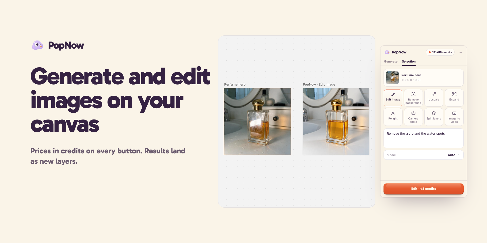

# PopNow for Figma and FigJam

Generate images and edit the selected layer with your PopNow account, without leaving the canvas.
Every button shows its price in credits before anything starts, and results land as new layers next to
the original. Nothing is overwritten.

PopNow AI ([popnow.ai](https://popnow.ai)) is the world's first AI studio with automatic price protection.



## What it does

| Where | Action | PopNow tool |
| --- | --- | --- |
| Generate tab | Generate (prompt, shape, model; Auto picks PopNow's default) | `create_image` |
| Selected layer | Edit image | `edit_image` |
| | Remove background | `remove_background` |
| | Upscale (2K, 4K, 8K) | `upscale` |
| | Expand (16:9, 9:16, 1:1, 4:3, 3:4, 3:2) | `expand_image` |
| | Relight | `relight_photo` |
| | Camera angle | `change_camera_angle` |
| | Split layers (placed as one group) | `split_layers` |
| | Image to video (first frame plus a "Play video" link) | `create_video` |

Works the same in Figma design files and FigJam boards.

## How it works

- **Sign-in.** OAuth 2.1 with PKCE and a dynamically registered client, against `https://api.popnow.ai/mcp`.
  A plugin cannot receive a redirect, so PopNow sends the browser to
  [PopNow Connect](https://github.com/popnow-ai/popnow-connect) (`https://connect.popnow.ai/oauth/callback`).
  The panel makes a 32-byte `nonce`, sends `state = base64url(sha256(nonce))`, and polls
  `POST /oauth/claim {nonce}` every 1.5 seconds for up to five minutes. It checks `iss`, then exchanges the code
  with its own PKCE verifier. The relay never sees a token.
- **Tokens** live in `figma.clientStorage` and travel between the main thread and the panel only by
  `postMessage`. They are never logged. Sign out revokes them.
- **Calls** go to the account MCP endpoint (Streamable HTTP, JSON or event-stream replies). A 401 refreshes the
  token once; if that fails the panel asks you to sign in again.
- **Prices.** The panel asks `estimate_cost` (free) and writes the price on the button, for example
  `Edit · 48 credits`, even for small jobs like Remove background. A click runs the tool with
  `max_credits` set to that price. If PopNow now wants more, nothing starts and the new price goes on the
  button: the limit is never raised for you. If the balance is too low, the button is disabled and
  **Get credits** opens popnow.ai/pricing. If PopNow asks for consent about people in the image, you tick
  the box yourself.
- **Selected layers** are exported as PNG (`exportAsync`, at most 2048 px a side) and uploaded through a
  PopNow upload window (`request_upload` → `/console/v1/upload-sessions/…` → `get_upload`). The upload
  starts only after you picked a tool and filled in what it needs, and the same layer is uploaded once.
  The signed storage address never gets your PopNow token.
- **Long jobs** (videos) are polled with `get_job`. The progress bar shows the elapsed time. **Stop waiting**
  only stops waiting in the panel; PopNow keeps making it and it shows up in your library.

The main thread (`src/code.ts`) only touches the canvas. All network calls run in the panel
(`src/ui/main.ts`). The protocol code is plain TypeScript in `src/core/` (`oauth`, `mcp`, `upload`,
`pricing`, `actions`) and is tested against a fake PopNow and a fake relay.

## Develop

```bash
npm install
npm run typecheck
npm test               # core logic against a local fake PopNow and a fake PopNow Connect
npm run build          # dist/code.js and dist/ui.html
npm run package        # popnow-figma-<version>.zip
npm run screenshots    # store/screenshots/*.png and the store art, in headless Chrome
```

In Figma desktop: **Plugins → Development → Import plugin from manifest…** and pick `manifest.json`.
To try it against a local server, build with `POPNOW_MCP_URL=http://127.0.0.1:8787/mcp` and
`POPNOW_RELAY_URL=http://127.0.0.1:8788`, and add those origins to `devAllowedDomains`.

The `id` in `manifest.json` is a placeholder. Figma assigns the real one when the plugin is first published;
put it there before publishing.

## Network access

`manifest.json` allows only:

- `api.popnow.ai`: sign-in, prices, creations, upload windows
- `connect.popnow.ai`: the sign-in relay
- `*.r2.cloudflarestorage.com`, `media.popnow.ai`: PopNow storage (upload of the selected layer, download
  of results)
- `fonts.googleapis.com`, `fonts.gstatic.com`: the Gabarito font for the panel (falls back to system fonts)

## Privacy

See [PRIVACY.md](PRIVACY.md) and https://popnow.ai/privacy.

## License

MIT
